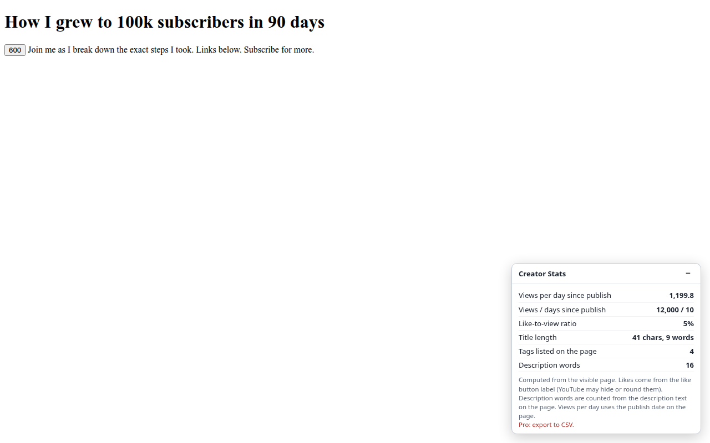
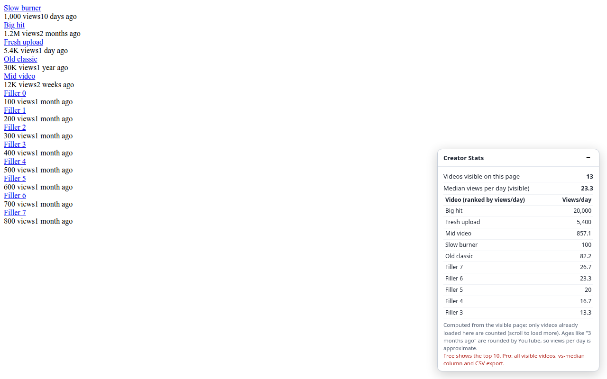
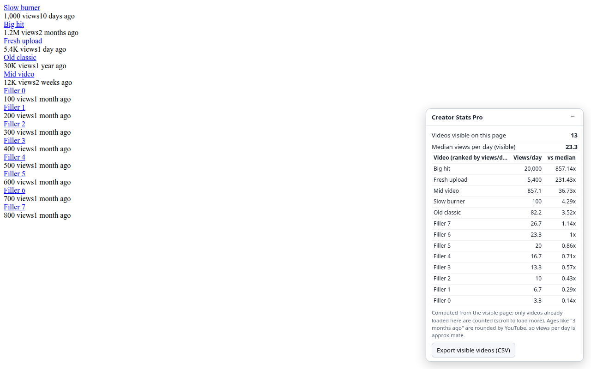

# Creator Stats for YouTube

A small panel on YouTube that turns numbers already on your screen into the ones creators compare. Not affiliated with YouTube or Google.

**Install (Firefox):** https://addons.mozilla.org/en-US/firefox/addon/creator-stats-for-youtube/

## What it does
- Watch pages: views per day since publish, like-to-view ratio, title length, tags listed on the page, description word count
- Channel Videos tab and YouTube Studio list: rank loaded videos by views per day, with the median
- Free shows the top 10 videos in a ranking. Ages like "3 months ago" are rounded by YouTube, so those rates are approximate.

## Data and privacy
No accounts, servers, analytics or network requests; it does not use the YouTube API. It reads text already rendered on the page you view and stores only your Pro key in `storage.local`. Permissions: `storage`, host access to youtube.com and studio.youtube.com.

See [PRIVACY.md](PRIVACY.md). Permissions are listed in `manifest.json`.

## Free and Pro
Free as described above. An optional Pro unlock is a one-time $4.99 payment (no subscription): Pro lists every visible video, adds a vs-median column and CSV export. Buy: https://buy.stripe.com/4gM7sE8HB0q0afM9aH0x41B ; the key is on the confirmation page. The key is checked on your device; the extension makes no network requests.

## Screenshots

## Load from source
In Firefox open `about:debugging#/runtime/this-firefox`, choose Load Temporary Add-on and pick `manifest.json` from this folder.

(c) KING HOLDINGS VENTURES LLC (King AI). Source published for transparency; all rights reserved. Contact: hello@usekingai.com
